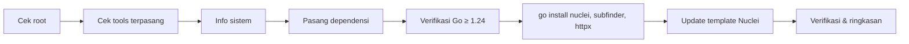

<div align="center">


<a href="https://github.com/teguhsibersec/pd-toolkit-installer">
  
</a>

<br/>


</div>

---

## ✨ Tentang

**PD Toolkit Installer** adalah skrip Bash untuk memasang tiga tools recon & vulnerability scanning populer dari [ProjectDiscovery](https://projectdiscovery.io) secara otomatis, rapi, dan tanpa ribet.

| Tool | Fungsi |
|------|--------|
| 🔎 **[subfinder](https://github.com/projectdiscovery/subfinder)** | Enumerasi subdomain pasif yang cepat |
| 🌐 **[httpx](https://github.com/projectdiscovery/httpx)** | Probing HTTP/HTTPS, deteksi teknologi & status |
| ☢️ **[nuclei](https://github.com/projectdiscovery/nuclei)** | Scanner kerentanan berbasis template |

---

## 🚀 Fitur

- ⚡ **Instalasi satu perintah**: jalankan skripnya, sisanya otomatis
- 🧠 **Cek cerdas**: tools yang sudah terpasang akan dilewati
- 🐹 **Auto-upgrade Go**: jika Go dari `apt` kurang dari 1.24, skrip memasang Go terbaru dari go.dev
- 🌀 **Spinner animasi** di terminal, output tersimpan ke file log
- 🎨 **UI berwarna** (otomatis nonaktif jika output bukan terminal)
- 📦 **Update template Nuclei** otomatis setelah instalasi
- 🛡️ **Error handling** dengan `set -euo pipefail` dan `trap ERR` yang menunjukkan baris & perintah penyebab gagal
- 🧾 **Log lengkap** di `/var/log/teguhsibersec-install.log`

---

## 📋 Prasyarat

- Sistem berbasis **Debian / Ubuntu / Kali** (menggunakan `apt`)
- Akses **root** / `sudo`
- Koneksi internet
- Arsitektur `amd64` atau `arm64`

---

## ⚙️ Instalasi

```bash
git clone https://github.com/teguhsibersec/pd-toolkit-installer.git
cd pd-toolkit-installer
sudo bash nuclei-subfinder-httpx-installer.sh
```

Atau langsung satu baris:

```bash
curl -fsSL https://raw.githubusercontent.com/teguhsibersec/pd-toolkit-installer/main/nuclei-subfinder-httpx-installer.sh | sudo bash
```

---

## 🔄 Alur Kerja



---

## 🖥️ Contoh Output

```text
[1/6] Memeriksa sistem
  ℹ  OS          : Kali GNU/Linux Rolling
  ℹ  Arsitektur  : amd64

[2/6] Memasang dependensi
  ✔  Memperbarui indeks paket (apt update)
  ✔  Memasang golang-go, git, curl, wget

[4/6] Memasang tools ProjectDiscovery
  ✔  Compile & install nuclei
  ✔  Compile & install subfinder
  ✔  Compile & install httpx

  ✔ INSTALASI SELESAI  (142 detik)
```

---

## 🧪 Contoh Penggunaan

Pipeline recon klasik: temukan subdomain, cek yang aktif, lalu scan kerentanan.

```bash
subfinder -d example.com -silent | httpx -silent | nuclei -severity high,critical
```

---

## 🔁 Memperbarui Tools

Skrip akan berhenti jika semua tools sudah ada. Untuk update, hapus binary lama lalu jalankan ulang:

```bash
sudo rm /usr/bin/{nuclei,subfinder,httpx}
sudo bash nuclei-subfinder-httpx-installer.sh
```

---

## 🩺 Troubleshooting

| Masalah | Solusi |
|---------|--------|
| `Script ini harus dijalankan sebagai root` | Jalankan dengan `sudo` |
| Instalasi gagal di tengah jalan | Cek log: `cat /var/log/teguhsibersec-install.log` |
| Update template gagal | Jalankan manual: `nuclei -update-templates` |
| Perintah tidak ditemukan setelah install | Buka terminal baru atau jalankan `hash -r` |

---

## ⚠️ Disclaimer

Tools ini ditujukan untuk **keperluan edukasi dan pengujian keamanan yang sah**. Gunakan hanya pada sistem/target yang **Anda miliki atau memiliki izin tertulis** untuk diuji. Penulis tidak bertanggung jawab atas penyalahgunaan.

---

## 🤝 Kontribusi

Pull request dan issue sangat diterima. Fork repo ini, buat branch baru, lalu ajukan PR.

---

<div align="center">

**Dibuat dengan ☕ oleh [teguhsibersec](https://github.com/teguhsibersec)**

⭐ Jika skrip ini bermanfaat, jangan lupa beri **star**!


</div>
